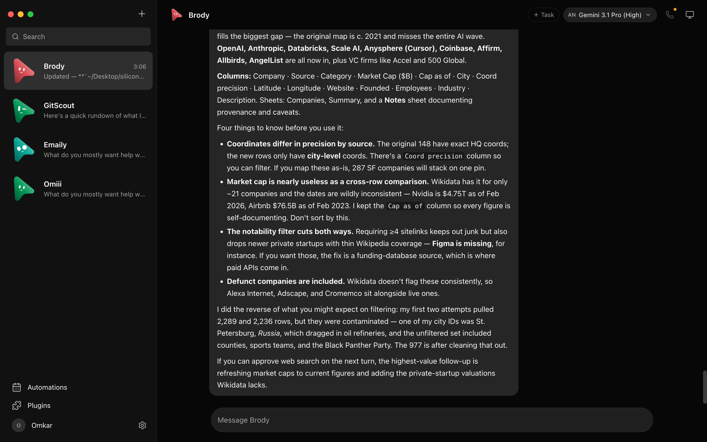
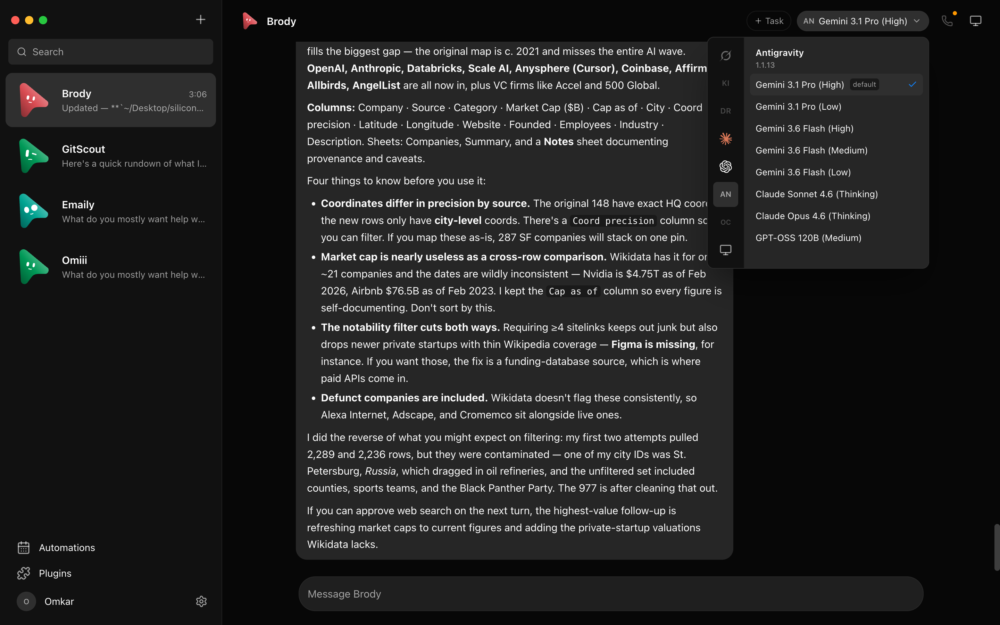
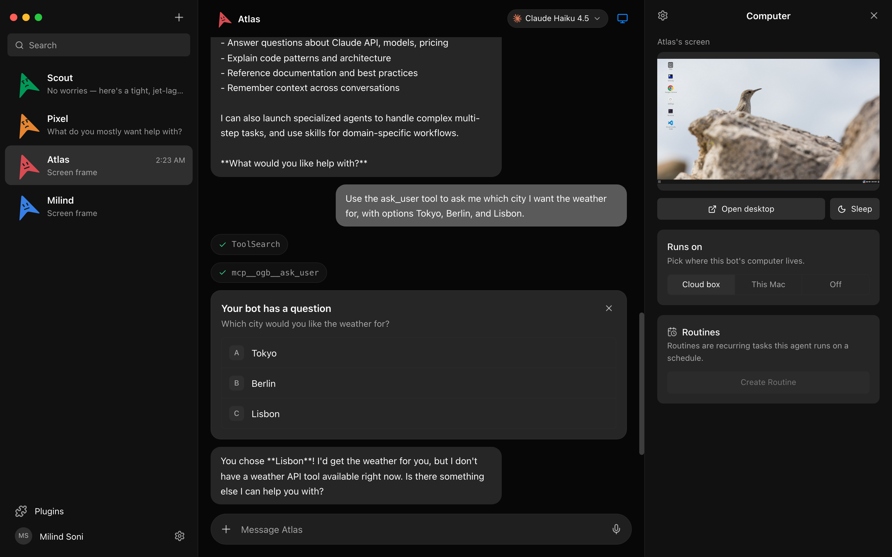
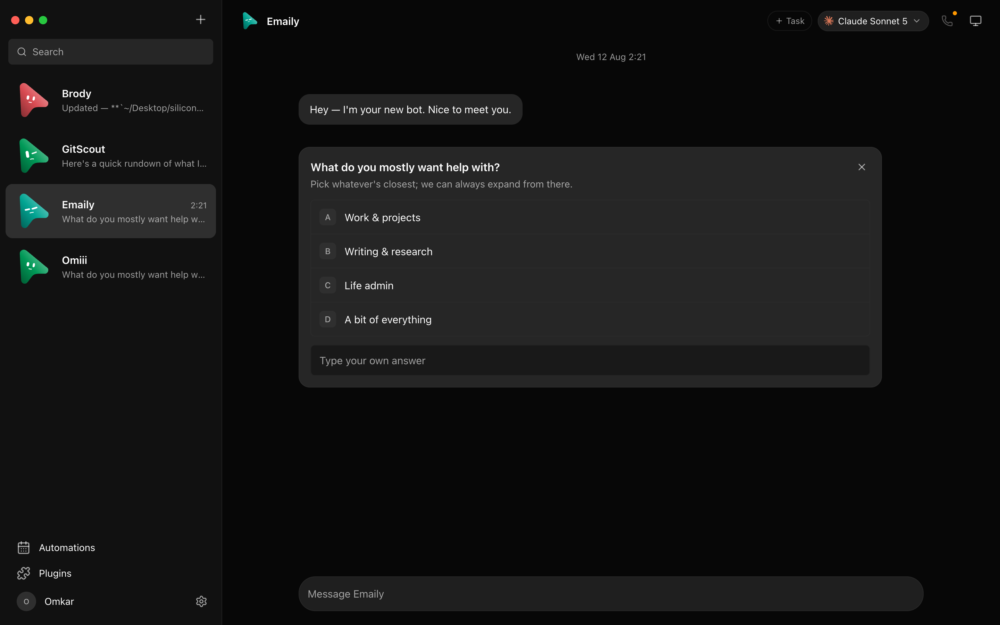
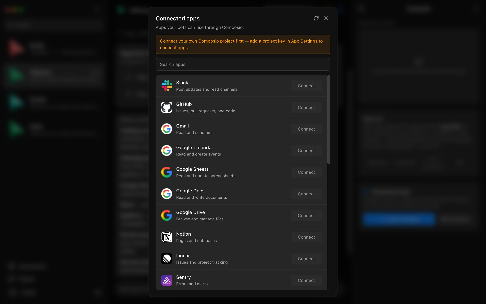
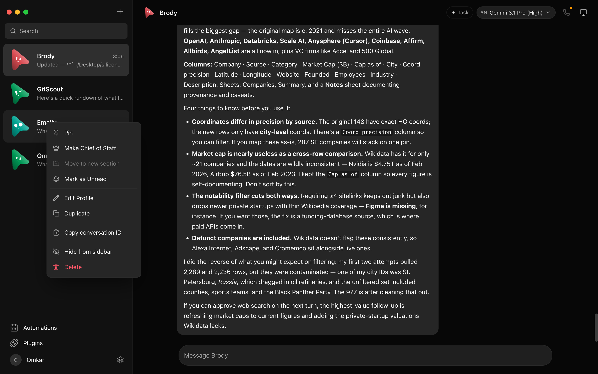
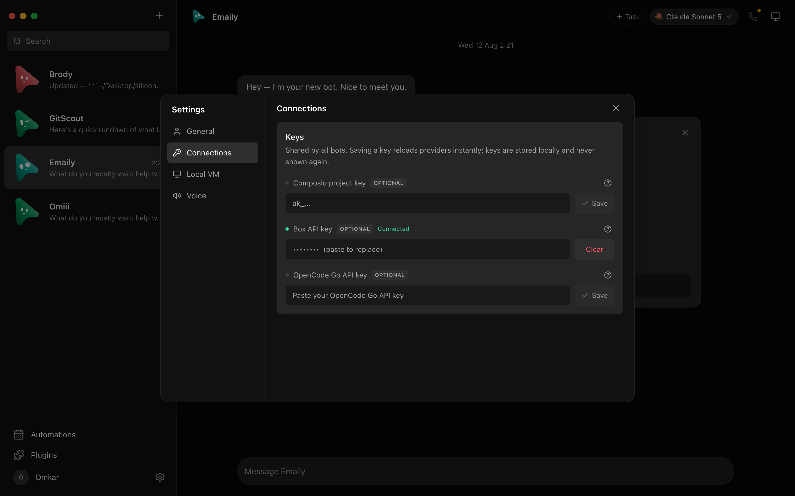

> **[中文化] OpenMausBot**
>
> 此项目是 [milind-soni/OpenMausBot](https://github.com/milind-soni/OpenMausBot) 的中文翻译版本。
> - 原项目 Stars: 4770
> - 主语言: TypeScript
> - 许可证: Apache-2.0
> - 翻译日期: 2026-10-14
> - 原始 README: [README_en.md](README_en.md)
>
> 说明：下方 README 正文为**原项目文档的中文翻译**，力求忠于原文；本页顶部的「中文快速上手」为**面向中文用户的补充导读**（非原文内容），目的是让你不用读完整篇 README 就能先把项目跑起来。
>
> 如有翻译不准确之处，欢迎提 Issue 或 PR。

---

## 🚀 中文快速上手（补充导读，非原文）

### 这是什么 / 解决什么问题

OpenMausBot 是一个本地优先（local-first）的桌面聊天应用，把「一队 AI 智能体」做成类似即时通讯软件的形态：侧边栏里每个 bot 都是一个真实运行的 agent（底层跑 Claude 或 Codex），各自有独立的人格、模型、云端电脑和已连接的应用。它想解决的问题是：单个助手放在一个对话框里不适合 agent 场景，而它把「AI 即消息应用」这个思路重建成开源、本地优先、跑在你已有 agent 上的版本。项目自称是 Grok Bot 的开源替代品，与 xAI、Meta、OpenAI、Manus 均无关联。

### 快速上手（最短路径）

1. 直接下载安装包（README 顶部提供官方下载按钮）：
   - Mac（Apple silicon）：`OpenMausBot.dmg`
   - Mac（Intel）：`OpenMausBot-intel.dmg`
   - Windows：`OpenMausBot-setup.exe`
   - Ubuntu 24.04 x64：`OpenMausBot-amd64.deb`（或 AppImage beta）
2. 也可从 [latest release](https://github.com/milind-soni/OpenMausBot/releases/latest) 页面获取全部版本。
3. 若要从源码构建：`package.json` 显示包管理器为 `pnpm@10.33.0`，Node 要求 `>=24`；但 README 材料中**未提供**完整的源码构建/启动命令，请参考下方 README 正文。
4. 用 Docker 构建 harness server（Dockerfile 注释中给出的命令）：
   - `docker build -t openmausbot .`
   - 指定引擎：`docker build --build-arg ENGINES="@anthropic-ai/claude-code @openai/codex" -t openmausbot .`
   - 构建 cloud-home 目标：`docker build --target cloud-home -t omb-cloud-home .`

### 环境要求

- **操作系统**：macOS（Apple silicon 与 Intel）、Windows（x64）、Ubuntu 24.04 x64。README 徽章标注 Electron 支持 macOS · Windows · Ubuntu。
- **硬件**：原文未说明具体硬件门槛（仅区分 Mac 的 Apple silicon 与 Intel 两种安装包）。
- **依赖**：bots 运行在你本机已安装的 `claude`、`codex`、`grok` CLI 上，使用你已有的登录和订阅；无需新账号。源码构建需 Node `>=24`、pnpm `10.33.0`。
- **版本要求**：Ubuntu 24.04 x64；Docker 镜像基于 `node:24-bookworm-slim`。
- **网络提示**：材料未提及国内镜像源或加速下载方案，如需可自行考虑更换 npm/镜像源（原文未说明）。

### 常见坑与注意事项

- **需要本机已装 agent CLI**：bots 依赖你机器上的 `claude`、`codex`、`grok` CLI 及其登录，没有这些则无法运行。
- **平台功能限制**：主机控制（host control）仅在 macOS 和 Ubuntu Xorg 上、且显式 opt-in 后可用；Ubuntu Wayland 的主机控制因 issue #345 未解决而处于禁用状态。
- **数据与状态位置**：transcripts、keys、events 存放在 `~/.openmausbot`（Docker 中 HOME 为 `/data` 卷，用于跨容器重启持久化）。
- **加密货币无关声明**：项目明确声明没有任何代币，任何使用 OpenMausBot / Maus / SupaMaus 名称的币都与本项目无关。

---

---

# OpenMausBot

**开源的 Grok Bot 替代方案：在聊天应用中拥有你自己的 AI 机器人团队。**

[**openmausbot.com**](https://www.openmausbot.com) &nbsp;·&nbsp; [下载](https://www.openmausbot.com/download) &nbsp;·&nbsp; [开源 Grok Bot 替代方案对比](https://www.openmausbot.com/blog/grok-bot-vs-openmausbot)

OpenMausBot 是一个开源的 Grok Bot 替代方案：一个受 **Grok Bot** 启发的独立项目，也是 **Meta Muse**、**OpenAI dots** 和 **Cue by Manus** 的开源替代品——自带 Agent、本地优先、使用你已有的模型。又名 **MausBot**；曾用名 **OpenGrokBot**。与 xAI、Meta、OpenAI 或 Manus 无关联。

侧边栏中的每个机器人都是一个真正的 Agent——底层在本地运行 Claude 或 Codex——拥有自己的
个性、自己的模型、自己的云电脑，以及自己连接的 App。
像联系人一样与它们对话。观看它们工作。审批重要操作。

 

&nbsp;

&nbsp;

&nbsp;

[最新发布版本](https://github.com/milind-soni/OpenMausBot/releases/latest) &nbsp;·&nbsp; macOS：Apple 芯片与 Intel · 已签名并公证的 .dmg &nbsp;·&nbsp; Windows：x64 安装程序 &nbsp;·&nbsp; Ubuntu 24.04 x64：.deb 或 AppImage 测试版 &nbsp;·&nbsp; [所有发布版本](https://github.com/milind-soni/OpenMausBot/releases)

 

 
 

---

> ⚠️ **与任何加密货币均无关联。** OpenMausBot 没有代币。任何使用 OpenMausBot、Maus 或 SupaMaus 名称的币种均非由本项目或其维护者创建、认可或关联。我未从任何人处收到代币、付款或配额，也不会为任何代币背书。

## 为什么

一个盒子里的一个助手并不适合 Agent 的形态。OpenMausBot 是一个受 **Grok Bot** 启发的独立开源项目——
它保留了核心理念（AI 即*消息应用*：一组可聊天的机器人，每个都有自己的个性、
对话记忆、模型、电脑和 App），并以开源、本地优先的方式重建，运行在你已有的 Agent 之上：

- **自带 Agent。** 机器人运行在你本机安装的 `claude`、`codex` 和 `grok` CLI 上
  ——使用你现有的登录和订阅，无需新账号，中间无代理。可在 **设置 → 引擎** 中将任意引擎指向
  自定义 CLI 二进制文件（特定版本构建或包装脚本）。
- **本地优先。** 一个运行在 `127.0.0.1` 上的小型 harness 服务器管理所有 Agent 进程。对话记录、密钥和
  事件存放在 `~/.openmausbot`，而非云端。
- **有手脚的 Agent。** 每个机器人可使用云 Linux 桌面、隔离的本地虚拟机，或在平台
  安全边界已通过认证的情况下——使用你自己的电脑，并通过 Composio 接入 500+ App。主机控制在
  macOS 和 Ubuntu Xorg 上经明确选择加入后可用。Ubuntu Wayland 主机控制在
  Issue #345 解决前保持禁用。

## Grok Bot、Muse、dots 和 Cue 的开源替代方案

2026 年的七周内发布了四款闭源个人 Agent 产品，每一款都将模型、
电脑和你的数据留在其厂商一侧。OpenMausBot 是这种形态的开源版本：
聊天应用中的 Agent 团队，每个都有自己的模型、自己的电脑和自己的已连接
App，在 Apache 2.0 许可下运行于你的机器上。如果你搜索过 *open Muse*、*open dots*、
*开源 Grok Bot*、*open Instinct* 或 *open Cue*，这就是你要找的仓库。

| 你在找 | 它是什么 | OpenMausBot 有何不同 | 了解更多 |
| --- | --- | --- | --- |
| **开源 Grok Bot** | xAI 的机器人阵容，共享一台云电脑，仅限 Grok，需 SuperGrok 或 Cursor 套餐 | 相同的阵容形态；每个机器人可用任意模型；你自己的机器；审批卡片 | [Grok Bot vs OpenMausBot](https://www.openmausbot.com/blog/grok-bot-vs-openmausbot) |
| **Open Muse** | Meta 的单一个人 Agent，运行在 Meta 云虚拟机中，仅限美国和加拿大 | 一个团队而非单个 Agent；随处可运行；数据存于 `~/.openmausbot` | [Meta Muse 替代方案](https://www.openmausbot.com/blog/open-source-alternative-to-meta-muse) |
| **Open dots** | OpenAI 的常驻 Agent，内置于 ChatGPT，仅限 GPT，需 Pro 和 Business Premium 套餐 | 多个 Agent；使用你的 Claude、ChatGPT 或 Grok 登录；无需套餐 | [OpenAI dots 替代方案](https://www.openmausbot.com/blog/openai-dots-alternative) |
| **Open Cue** | Manus 的邀请制 Agent，拥有自己的手机、邮箱和钱包 | 无需邀请；使用 OAuth 而非密码；开源 | [Cue by Manus 替代方案](https://www.openmausbot.com/blog/open-source-alternative-to-cue-by-manus) |
| **Open Instinct** | Spear Street 的邀请制 Agent，在云电脑上保存你的密码 | 行动前先询问；通过 OAuth 登录；运行在你的机器上 | [Instinct AI 替代方案](https://www.openmausbot.com/blog/instinct-ai-alternative) |

五者并排对比：[Muse vs Grok Bot vs Dots vs Cue](https://www.openmausbot.com/blog/muse-vs-grok-bot-vs-dots-vs-cue)，
以及五个问题的决策指南：[我该用哪个 AI Agent？](https://www.openmausbot.com/blog/which-ai-agent-should-i-use)

## 功能

<table>
<tr>
<td width="50%" valign="top">

### 🧠 为每个机器人选择大脑

带提供商侧栏的模型选择器——Claude 和 Codex 模型并排显示，默认项已标记，不可用的
提供商变暗并显示原因。可在对话中途切换机器人的模型。

</td>
<td width="50%" valign="top">

### 🖥️ 每个机器人都有一台电脑

打开电脑面板，机器人的云桌面会自动启动——工作时实时屏幕预览，
"打开桌面"可在浏览器中接管，或将机器人指向*这台 Mac*。

</td>
</tr>
<tr>
<td width="50%" valign="top">

### 🙋 机器人行动前先询问

Shell 命令、文件编辑和问题以行内卡片形式呈现——允许 / 拒绝 / 在聊天中回答。
权限代理将每个风险操作变为由你做出的决定，云电脑和本地电脑皆如此。

</td>
<td width="50%" valign="top">

### 🔌 已连接的 App

基于 Composio Sessions 的一键市场：Gmail、Slack、GitHub、Notion、Linear 及数百个更多。
OAuth 一次，每个机器人即可将它们作为工具使用。

</td>
</tr>
<tr>
<td width="50%" valign="top">

### 🗂 像管理聊天一样管理机器人

右键任意机器人：置顶、标记未读、编辑资料、复制、复制对话 ID、隐藏、删除。这是一个
消息应用——你的 Agent 行为如同联系人。

</td>
<td width="50%" valign="top">

### 🔑 密钥一次配置，全部点亮

在 App 设置中粘贴凭据——它们本地持久化，提供商集群即时热重载。
密钥为只写：UI 只能看到"已配置"标志。

</td>
</tr>
</table>

### #️⃣ 为每种场景创建频道

将工作、个人和每个项目放在独立频道中，无需克隆机器人。每个频道有自己的
对话记录、共享指令、工作文件夹、响应规则和可编辑的机器人名单。将频道及其机器人
归入命名上下文，团队变化时可随时重命名或更改成员。

### ⚡ 用 Jev 快速决策

在 **设置 → 决策模型** 中添加 TypeSafe Jev 密钥，设为 **自动** 的房间会在几百毫秒内
为每条未被提及的消息选择最合适的机器人，当 Jev 关闭或不确定时回退到房间的主机器人。
参见 [docs/decision-model.md](docs/decision-model.md)。

### 📦 从一个 Markdown 文件安装完整团队

在 [BotMRR](https://botmrr.io) 上浏览成果驱动的团队，然后选择 **添加到 OpenMausBot**。App
会在创建机器人、幕僚长、频道、手册、连接器清单和建议例程之前打开审核界面。
你也可以从磁盘导入相同的 `.md` 文件，或在 **团队 → 导入** 中粘贴其公开 GitHub URL。

格式保持可移植：OpenMausBot 读取结构化 YAML frontmatter 以实现可靠的一键
安装，而 Grok、Claude、ChatGPT 和人类可以遵循普通的 Markdown 手册。连接
在你批准前保持关闭，例程以暂停状态到达，包中绝不携带凭据、
对话、权限、记忆或电脑访问权。浏览
[开源手册仓库](https://github.com/milind-soni/openmausbot-teams) 或阅读其
[可移植格式](https://github.com/milind-soni/openmausbot-teams/blob/main/FORMAT.md)。

### 🤝 分享整个团队

右键团队并选择 **分享团队…**（或使用 **模板 → 分享**）将整个团队保存为一个
文件：其机器人及其指令、图片和技能、群聊、例程、共享指令、
幕僚长、连接槽位以及每个机器人的起始笔记（取消勾选可排除）。对话框
在你保存前会准确显示文件包含的内容。聊天历史、密钥和密码、模型选择和
电脑绝不包含在内，任何看起来像机密的内容都会从文本中移除。导入者
获得的机器人默认为询问模式，技能关闭，例程暂停。参见 [docs/team-sharing.md](docs/team-sharing.md)。
连接到组织的桌面还会看到 **模板 → 来自 {组织}**：其管理员分享的包，
一键添加，技能开启。参见 [docs/org-library.md](docs/org-library.md)。
你的新建机器人默认值也可以随行，作为 **预设机器人** 出现在新建机器人中（在团队文件中，或
单独通过 **分享为预设…**）。参见 [docs/presets.md](docs/presets.md)。

### 🎧 会回话的机器人

按任意回复上的扬声器，或将机器人切换为在回答到达时朗读——这样你可以在
做早餐时收听夜间运行的内容。点击 **通话** 即进入对话：它听到你，在工作时
告诉你它在做什么，并大声请求审批。

在 Agent 配置中选择 ElevenLabs、Fish Audio、Grok（xAI）、内置 Mac 语音或本地 Chatterbox 服务器。需要时
粘贴一次云密钥，选择语音，每个机器人都能说话。
给机器人自己的语音，频道就不再听起来像一个人。

对于 Grok，在 **设置 → 连接** 中保存你的 xAI API 密钥，然后在机器人的 **语音与提醒** 下选择 **Grok（xAI）**
和语音。它复用该主机端密钥，为语音回复和通话返回 MP3
音频。语言从回复文本自动检测；
在 xAI [官方支持的语言](https://docs.x.ai/developers/model-capabilities/audio/text-to-speech) 之外质量可能有所不同。
这为现有通话流程添加了语音合成；麦克风转录保持不变。

**还包括：** 带工具运行活动芯片的流式回复 · 从编辑器麦克风进行原生 macOS 听写（设备端 Apple 语音识别——桌面应用）· 带角色感知
表情的 SupaMaus 光标吉祥物 · 机器人工作的截图折叠进对话记录。

## 技术支持

![GitHub Sponsors](https://img.shields.io/b