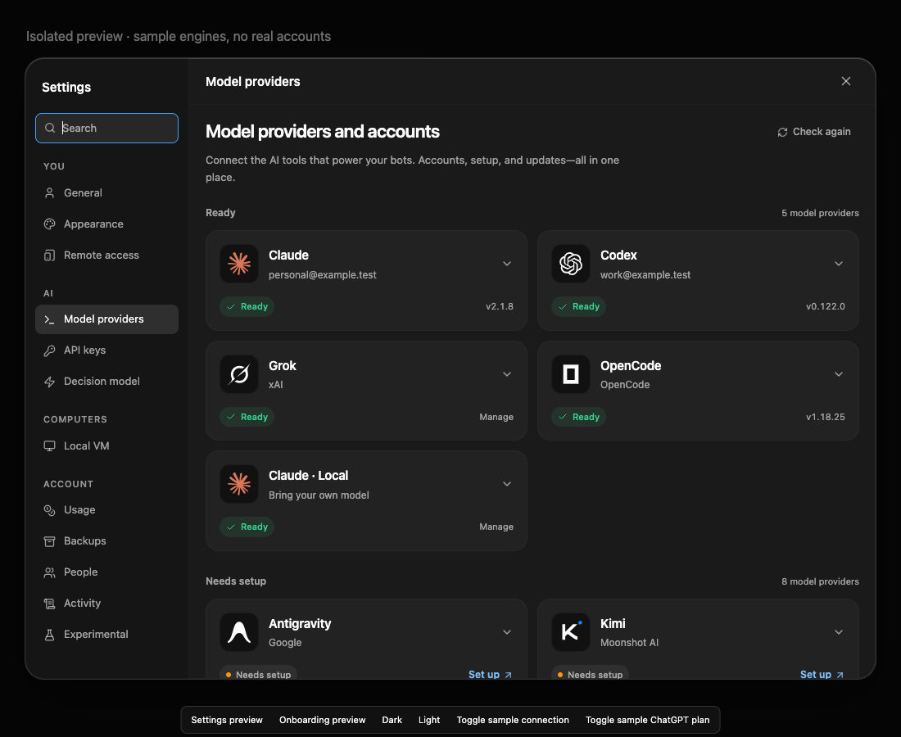
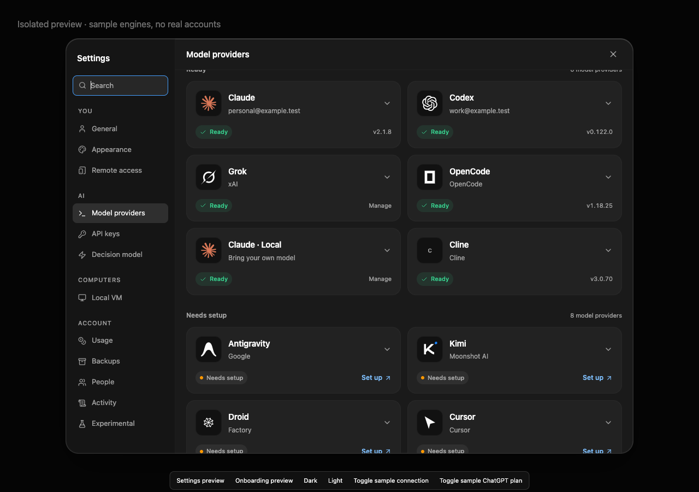
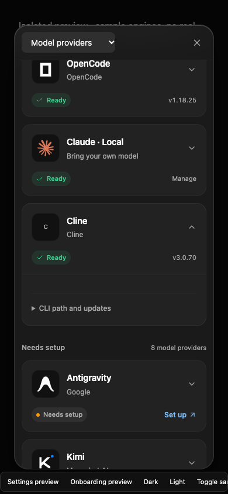
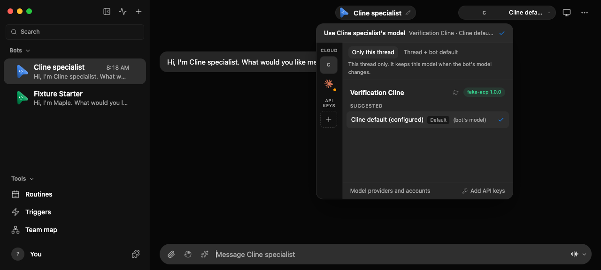

# Cline 引擎

安装独立的 Cline CLI（`npm install -g cline`），在终端运行 `cline auth` 选择提供商、模型和账号。OpenMausBot 的 **Cline** 模型提供商使用 **Cline 默认（已配置）**；提供商/模型选择仍由 Cline 负责。CLI 缺失或账号未配置时，该提供商不可用。需要带 `--config` 或 `--data-dir` 的包装脚本时，使用 **Set CLI**。

驱动只读取 Cline 版本 1 `data/settings/providers.json` 中选中的条目，不会改写它。对于已保存的 API 提供商，ACP 目前需要将所选 API key 放入 `CLINE_API_KEY`；OAuth 登录和刷新仍由 Cline 负责。已保存的自定义模型会在提示词之前通过 ACP 固定，避免它静默回退到目录中的模型。

权限始终经过 OpenMausBot 的 ACP 审批代理，包括 Full Access。Cline 的终端自动批准默认值被显式禁用。MCP 工具使用现有的作用域集成门控。不支持原生工具选择：从机器人允许列表中移除原生工具会被拒绝。MCP 凭据变更会先重启缓存的原生进程，再恢复运行。已发布的 CLI 会记录 ACP 的 MCP 列表但不连接它；驱动使用 `CLINE_MCP_SETTINGS_PATH`，通过每个线程私有的文件连接同一份门控列表。空列表会禁用环境中的 Cline MCP 服务器。引擎销毁时这些文件会被删除；用户的 MCP 设置不受影响。

## 自动化检查

```sh
pnpm exec vitest run server/drivers/acp/cline.test.ts server/drivers/acp/acp.test.ts server/config.test.ts
```

这些契约测试使用假 CLI 和一次性 home 目录。覆盖引擎发现、作用域团队 MCP 配置、凭据隔离、已配置模型的选择与拒绝、配置格式错误、权限拒绝、Full 到 Ask 的转换、取消以及可执行文件缺失。

要在没有付费提供商或真实账号的情况下验证实际安装的 CLI：

```sh
OMB_CLINE_NATIVE_PATH=/path/to/cline pnpm exec vitest run scripts/testing/cline-native.e2e.test.ts
```

该测试会创建一次性 Cline home，配置回环 API 提供商，发送一次原生对话轮次，并检查收到的模型、一次性 notes MCP 工具的发现与执行、流式规范回复、成功结算以及提供商设置未变。第二个用例在 Ask、Full、再 Ask 下请求无害的 shell 标记写入：只有显式批准的 Full 轮次可以写入标记，且三次都必须发出规范审批请求。意外的执行请求会被拒绝。仅元数据证据写入 `.omb-scratch/verify-evidence/`；临时 home 会被删除。

产品工作流也由 `server/cline-engine.e2e.test.ts` 覆盖：Chief 通过 `list_team_setup` 发现 Cline，创建 Cline 专家，其对话轮次通过常规 harness 结算。该工作流使用假提供商 CLI；只有上面可选的 native 用例会真正执行 Cline。

```sh
OMB_UI_E2E=1 pnpm exec vitest run scripts/testing/cline-ui.e2e.test.ts
```

该用例将真实聊天渲染器挂载到一次性服务器和假提供商 CLI 上。它在 Simple 和 Advanced 模式下选择已配置的 Cline 模型，通过 API 验证保存的选择，并通过输入框发送专家消息。它检查存储的回复和浏览器控制台，然后关闭自己拥有的浏览器配置、预览和服务器。

## UI 与账号检查

`node --experimental-strip-types scripts/verify-engines-ui.ts` 使用合成的 Cline 卡片渲染真实的提供商设置界面；安装和认证请求被阻止。捕获桌面和窄屏布局。

对于专用测试账号，用所选 API 提供商或 OAuth 账号检查 `cline auth`，为新机器人选择 Cline，并发送一轮对话。作为 Chief，使用 `list_team_setup` 确认 Cline 引擎/模型条目；配置 Cline 专家并验证作用域团队通信。在 Ask 中拒绝一次执行，取消正在运行的轮次，然后测试 Full 后接 Ask。在声称通过原生 Linux 或真实 OAuth 验证之前，在 Linux 上重复上述步骤。回环用例不能证明付费提供商、OAuth 刷新或原生 Linux 执行。

## 初始验证

2026-10-11，两个 native 用例在运行 macOS 26.6.2 的物理 Mac 上使用 Cline 3.0.70 通过。模型提供商是自有的回环 fixture，不是付费模型或真实账号。未测试原生 Linux 和真实 OAuth。

设置截图使用真实渲染器和合成的引擎状态。模型选择器和输入框用例也在两种界面模式下使用假提供商 CLI 通过；它不声称另一次原生 Cline 执行。

| 之前：引擎目录中没有 Cline | 之后：Cline 已设置并配置为默认 |
| --- | --- |
|  |  |



