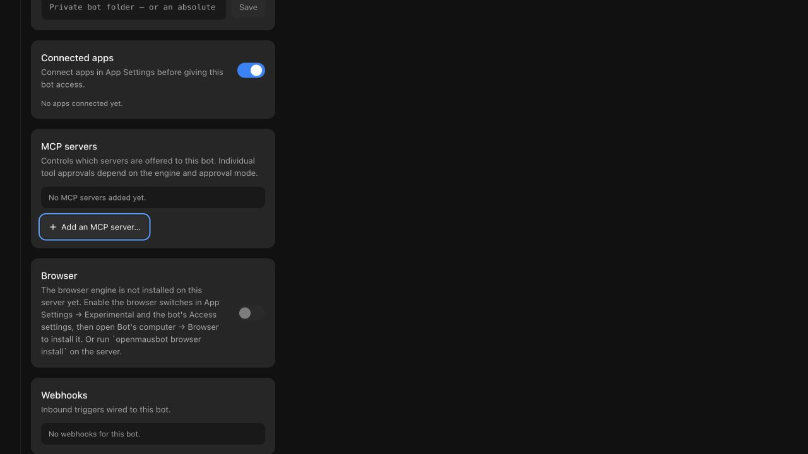
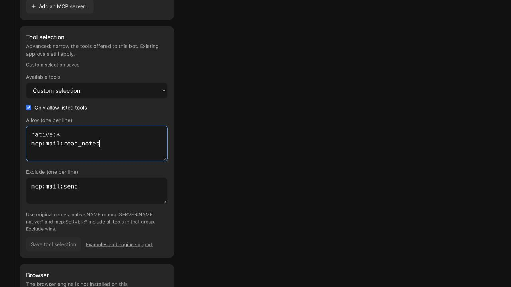

# 每个 Bot 的工具选择

以下所有检查均使用一次性 home、工作区和 MCP 服务器。它们不会读取用户的 OpenMausBot 数据，也不会连接真实邮件账户。

## 可重复的自动化检查

```sh
pnpm exec vitest run shared/tool-scope.test.ts server/mcp-gate.test.ts server/mcp-gate-config.test.ts server/mcp-remote-proxy.test.ts
pnpm exec vitest run server/store.test.ts server/tool-scope.e2e.test.ts server/drivers/tool-scope-coverage.test.ts server/drivers/acp/tool-scope.test.ts
pnpm exec vitest run server/drivers/pi.test.ts server/drivers/pi-mcp-extension.test.ts server/drivers/chat-mcp-tools.test.ts server/drivers/openai-chat.test.ts server/openai-tools.e2e.test.ts
pnpm exec vitest run src/components/bot-settings/AccessSection.test.ts src/state/store.test.ts src/lib/create-configured-bot.test.ts src/lib/bot-creation-draft.test.ts
OMB_UI_E2E=1 pnpm exec vitest run scripts/testing/tool-selection-ui.e2e.test.ts
```

UI 检查会打开真实的 bot 设置并执行保存、清除、拒绝无效输入、重试失败的保存、在保存进行中切换 bot、检查忙碌状态，以及原子化复制受限 bot。它使用共享验证启动器和真实渲染器。这些是使用假引擎的工作流检查，不是实时模型规划检查。




网关检查覆盖 stdio、HTTP 和 SSE 的发现与执行、分页、原始名称、格式错误的设置/协议输入、凭据安全的错误、零结果预算以及无源码的打包辅助程序。适配器检查覆盖全新和恢复的策略、审批模式、实例限制、不支持的引擎以及提示前的拒绝。被排除的工具必须既不出现在提供方的定义中，**也**不出现在夹具的执行日志中。

持久化检查会注入失败的保存，并在实际 API 创建的第一条记录后中断。更宽的工具访问权限只有在保存成功后才生效；如果持久化失败，运行时撤销仍然有效。显式选择和继承的默认值会出现在第一条持久化的 bot 记录中，因此被中断的创建不会以不受限的目录重新开始。

损坏的已保存选择会在追加消息或准备计算机之前，以 HTTP 409 拒绝直接发送。隔离的 API 回归还会验证转录未改变，且未启动任何提供方。

## 官方 CLI 契约检查

将官方 Pi CLI 安装到一次性前缀中，然后提供其绝对路径。脚本会自行配置回环合成提供方：

```sh
node --experimental-strip-types scripts/verify-pi-tool-scope.ts /absolute/path/to/pi
node --experimental-strip-types scripts/verify-tool-scope.ts /absolute/path/to/grok
pnpm build:server
node --experimental-strip-types scripts/verify-pi-tool-scope.ts /absolute/path/to/pi dist-server/drivers/pi-mcp-extension.ts
```

已验证的契约：**Pi 0.99.1**、**Grok 1.0.41**。Pi 检查延迟包工具激活以及原生/自定义工具。Grok 检查继承的 profile、模型特定的 harness 变更、恢复的选择、显式 MCP 辅助程序、托管网关抑制以及对意外原生 MCP 服务器的拒绝。这些脚本有意通过合成提供方请求被扣留的工具，并检查它们从未执行。它们不对模型进行基准测试。

Grok 的受限 profile 在请求的模型上建立，默认 harness 在 spawn 前固定。会话必须在提示前确认所选模型；冗余的模型切换不得恢复工具或拒绝原本有效的恢复 profile。未知的继承 harness 和未验证的原生选择运行时版本会拒绝该轮次。官方 CLI 探针还会检查被注释的 agent 标题以及对带引号/点号语法的拒绝。单元检查覆盖内联表格、CLI 覆盖和模糊 profile。Codex 的真实网关子进程回归在新/恢复线程上测试两个服务器、原始发现和调用、被阻止的调用、独立的自定义审批以及私有环境变量剥离。

10 月 1 日审查跟进还通过 Codex **0.156.1** 和 **0.159.2** 测试了实际的原生 shell 命令，使用回环合成 Responses 提供方和同一台物理 Mac 上的一次性 home。Ask、Custom 和 Full 在新线程和恢复线程上均通过。命令的回执确认私有网关设置和现有的被排除夹具变量不存在，而配置的无害变量仍然可用。受限轮次会禁用继承的 shell 快照，因为快照可能在环境过滤后恢复变量。如果无法确认该覆盖，或有效排除策略格式错误，则不发送提示。这些检查未使用真实 Codex 账户或付费模型。

## 真实本地模型检查

单独加载一个支持工具的本地模型，使用 **8192 token 上下文**、一个并行请求和显式临时标识符。通过运行时的已加载模型报告确认这些值，然后依次运行 Pi 和 Grok：

```sh
node --experimental-strip-types scripts/verify-local-tool-selection.ts pi /absolute/path/to/pi http://127.0.0.1:1234/v1 MODEL_ID
node --experimental-strip-types scripts/verify-local-tool-selection.ts grok /absolute/path/to/grok http://127.0.0.1:1234/v1 MODEL_ID
```

代理转发实际模型响应和未修改的工具 Schema。它将生成限制在 768 token，每轮限制在 12 个请求。它捕获 Schema 名称/字节数和提供方报告的使用量，等待响应证据，并检查文件和 MCP 执行回执。完成后只卸载测试模型；保持其他项目和本地模型服务运行。

### 物理 Mac 证据，2026-09-30

在 arm64 macOS **26.6.2 (25G83)**、**24 GiB RAM** 上执行。运行时：LM Studio CLI commit `1017bcb`，llama.cpp Metal 后端 **2.48.0**。模型：`lmstudio-community/Qwen3.5-2B-GGUF`，**Q4_K_M**，仓库修订 `bb84e11355a036e28f080c7793fa6d22b7c4e344`。文件 SHA-256：`0bfe35afc9f05b7fac3fa04925e051ac7939a42a8a17ea11afc99701bea826cc`。已加载模型报告确认 8192 上下文和一个并行请求。

| 真实轮次 | Pi Schema / JSON 字节数 | Grok Schema / JSON 字节数 | 执行证据 |
| --- | --- | --- | --- |
| 起草 | 3 / 2297 | 3 / 3516 | 实际模型写入了请求的一次性文件 |
| 选定的邮件读取 | 1 / 182 | 2 个原生辅助程序 / 2840 | MCP 回执中仅出现 `read_notes` |
| 显式无工具 | 0 / 2 | 0 / 2 | 无终端标记且无额外 MCP 调用 |

Grok 会单独发送一个会话标题请求（一个 Schema，388 字节），该请求不计入主轮次计数。其合成默认目录对比为 25 个 Schema / 44415 字节；实时起草轮次的缩减目录为 3 / 3516。这不是对原始 Issue 中 97 工具设置的复现。

最终成功的 Pi 和 Grok 邮件轮次各进行了两次允许的读取调用。Grok 在继承 profile 和 Codex 网关审查修复后重新运行；Pi 的实现与其被接受的实时运行相比未改变。较早的一次小模型运行超出了请求预算并失败。通过的检查确立了工具可用性和执行边界，而非单次调用规划质量或一般模型可靠性。

提供方报告的使用量按每轮主请求汇总，包括完成 token 中的推理。Grok 的辅助标题使用量未提供。这些总计不是每请求上下文大小或金钱节省估算。

| 引擎 / 轮次 | 主请求数 | 提示 token 汇总 | 完成 token 汇总 |
| --- | --- | --- | --- |
| Pi 起草 | 2 | 3374 | 229 |
| Pi 邮件 | 2 | 1748 | 307 |
| Pi 无工具 | 1 | 608 | 123 |
| Grok 起草 | 3 | 9444 | 266 |
| Grok 邮件 | 5 | 14748 | 493 |
| Grok 无工具 | 2 | 4240 | 426 |

最大的单个提示为 Pi 的 1819 token 和 Grok 的 3434 token。夹具为其自身的一次性操作响应了两次 Pi 和三次 Grok 审批请求。未涉及真实账户、桌面或其他项目。

这些检查期间的整机快照报告空闲内存分别为 24%、22% 和 31%，交换分区使用量分别为 47716.50、47760.12 和 46146.38 MiB。已加载模型工作进程的采样 RSS 为 1242208 KiB。其他应用和测试设备保持运行。这些是点采样，不是隔离的峰值内存或因果性能对比。测试模型随后被卸载，一次性 agent 数据被移除。

## 必需的仓库检查与限制

运行 `pnpm typecheck`、`pnpm lint`、`pnpm test`、`pnpm check:electron` 和 `pnpm i18n:check`。在 Node 安装于非标准位置的 Mac 上，安装器测试的假 PATH 可能找不到 Node。在 pnpm 现有的 `node_modules/.bin` 中创建指向 Node 的临时链接，可通过 `OMB_EXTRA_PATH` 提供它。首先确认该目录不包含 npm 可执行文件，以便夹具的假 npm 仍被选中。在测试进程继承的 PATH 中使用相同的前导目录；PATH 契约测试会有意检查该顺序。之后仅移除为此测试创建的链接。不要前置真实 npm 安装或更改应用代码来修复机器的 PATH。

### 已完成的贡献检查

`pnpm typecheck`、`pnpm lint`、`pnpm check:electron`（145 个模块）和 `pnpm i18n:check`（10 种语言）通过。最终审查发现两个实质性问题；失败的回归在修复前复现了它们。最终受影响的检查通过了 349 个测试。之后一个仅测试的 Windows 清理修正又在 ACP 选择和 Pi 扩展套件中通过了另外 35 个测试。

完整的本地 `pnpm test` 链在组合验证 commit `4f66f395ef27da4dd93c2828dc17db9220bf62ef` 上通过：Vitest 10578 通过、70 跳过、1 todo（801 个文件通过，25 跳过）；broker 10 通过；Electron 513 通过，3 个既有跳过；全部五个无源码打包服务器检查通过，包括全部 13 个 spawn 的代理路径。托管检出中缺失的可选浏览器夹具不计为已测试。实际的工具选择渲染器工作流和上述截图在主检出中单独验证。

[最终组合 fork CI](https://github.com/BitL8-ByteShort/OpenMausBot/actions/runs/36804814592) 在 `738c5a8a586b6922b28a32947a06c05ba12abe62` 上通过了全部 26 项选定检查，包括 macOS、Ubuntu 和 Windows 上的全部 12 个 Vitest 分片、构建、渲染器、Electron 和无源码打包检查。部署被有意跳过。其树与功能 commit `299dc1994fc6f0fc073d7a6f826d4e180b7738be` 仅在两个 CI 前置测试文件上不同。新的 ACP 选择、Pi 扩展和容量清理套件在 Windows 上通过，无清理警告。现有 ACP 套件的临时 home 清理警告也出现在未更改的生产基线上。

[功能草稿 #2101](https://github.com/milind-soni/OpenMausBot/pull/2101) 将这些前置项排除在其 diff 之外。维护者预检修复 #2088 和 [Windows 清理草稿 #2100](https://github.com/milind-soni/OpenMausBot/pull/2100) 必须先落地，干净的功能分支才能拥有绿色的上游 CI。清理候选的精确 head 完整 fork CI 也通过了全部 26 项检查；其一个未更改的网络夹具失败和聚焦重跑在该 PR 中披露。组合绿色结果并不代表干净功能 head 上的 CI 为绿色。

[引擎支持表](../tool-selection.md#engine-support)区分了可用的原生选择、仅 MCP 支持和故障关闭的不支持限制。其他原生 CLI 契约、完整 Electron 包冒烟测试、真实连接账户、其他本地模型和其他 macOS 版本未由本验证确立。完整仓库套件和 CI 结果属于 Pull Request 的验证记录。